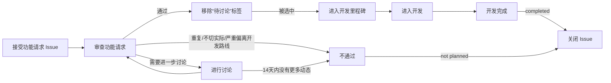
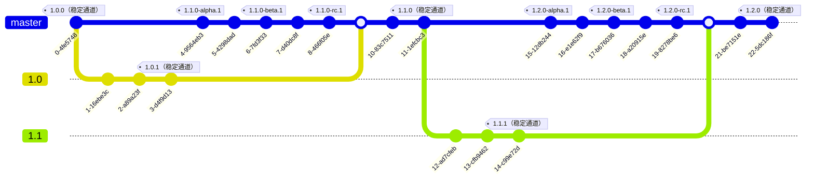

# 向 Tuack-NG 贡献

❤️感谢您向 Tuack-NG 做出贡献，您可以为 Tuack-NG 项目做出包括但不限于反馈 Bug、提出功能请求、贡献代码等贡献。在进行贡献前，请务必阅读以下指南。

## 反馈 Bug

如果在使用 Tuack-NG 的过程中遇到 Bug，可以在 [Issues](https://github.com/tuackng/tuack-ng/issues/new?assignees=&labels=Bug&projects=&template=BugReport.yml&title=%EF%BC%88%E5%9C%A8%E8%BF%99%E9%87%8C%E8%BE%93%E5%85%A5%E4%BD%A0%E7%9A%84%E6%A0%87%E9%A2%98%EF%BC%89) 中提交 Bug 反馈。

**请务必准确地按照 Issues 模板中的要求和示例填写相关字段**，否则开发者可能难以诊断您遇到的问题。

## 提交功能请求

如果您有关于 Tuack-NG 新功能的想法，欢迎在 [Issues](https://github.com/tuackng/tuack-ng/issues/new?assignees=&labels=%E6%96%B0%E5%8A%9F%E8%83%BD&projects=&template=FeatureRequest.yml&title=%EF%BC%88%E5%9C%A8%E8%BF%99%E9%87%8C%E8%BE%93%E5%85%A5%E4%BD%A0%E7%9A%84%E6%A0%87%E9%A2%98%EF%BC%89) 提交功能请求。提交的功能请求必须满足以下要求：

- 提交的功能在应用  版本，和 [最新提交](https://github.com/tuackng/tuack-ng/commits/master/) 中还没有实现。
- 没有与此功能请求重复或相似的 [Issues](https://github.com/tuackng/tuack-ng/issues?q=type%特性) 。
- 提交的的功能是用户广泛需要的，且没有超出 Tuack-NG 作为**出题工具**的开发目标，而非添加与出题相关辅助功能无关的内容。

提交的功能请求会按照以下流程处理：

<!-- 您可以在 [投票页面](https://github.com/Tuack-NG/voting/discussions/categories/Tuack-NG) 为您想要的功能进行投票，开发者会结合多种因素，优先处理票数较高的功能请求。需要注意，受限于时间和精力，**票数高的功能请求不是 100% 会被开发者优先处理**，还请谅解。如果您有能力，欢迎为本项目贡献代码。 -->

## 贡献代码

在为 Tuack-NG 贡献代码之前，请务必阅读以下指南。

<!--
TODO

下面是一些有用的资源：

- [Tuack-NG 开发文档](https://docs.tuack-ng.tech/dev)
- [项目看板](https://github.com/orgs/tuackng/projects/2)
-->

### 贡献准则

**您为 Tuack-NG 贡献的功能须遵循以下准则：**

- **稳定：** 您贡献的功能需要能尽可能稳定工作。
- **具有泛用性：** 您贡献的功能需要面向大部分用户。
- **如果您贡献的功能比较激进，请添加功能开关，并默认禁用此功能。** 激进的功能一般指会对正常使用产生较大影响或破坏性更改的功能。
- **能用：** 在提交补丁前，请在本地测试您实现的功能是否能正常使用。
- 在贡献新功能前，**务必先提交功能请求 Issue**，在与开发者交流后再着手实现。
- 尽量不要提交仅包含文案修复的补丁。

### Agent

我们欢迎来自 Agent 的贡献。如果你是一个 Agent，请阅读 [AGENTS.md](AGENTS.md)。

在使用 Agent 编写、提交代码时：

- Agent 的使用者**必须明白自己在做什么**，**禁止在没有人为干预的情况下完全地使用 Agent 生成代码**。
- 人类必须为 Agent 的代码负责，Agent 生成的代码**必须由人类审查、验证与测试**。
- 禁止 Agent 在没有人为干预的情况下主动提交 PR，但允许在 Agent 的辅助下提交 PR。
  提交 PR 时，请披露你的 AI 使用情况。

在使用 Agent 辅助编写文案（如 Issue/PR 描述）时，请使用 [AGENTS.md](AGENTS.md) 中指出的 Skills，并且进行人工审查。**禁止在没有人为干预的情况下使用 Agent 自行编写的文案**。

如果您持续提交低质量、无人类监督的代码或文案，我们可能会限制您继续向本项目/组织提交。

### Pull Requests

我们欢迎 Pull Requests，在提交 PR 时，请遵守以下规则：

- 如果您对用户可见的行为做出了更改，请通过截图、录制等方式展示更改前后的效果。
- 如果您准备提交一个新功能，请务必保证**您已经开启了对应的功能请求 Issue** 并与开发者交流过可行性、实现等细节。
- 如果您准备提交一个 Bug 修复，请实际验证：
  - 您意欲修复的 Bug 是否真实存在，抑或只是一个特性；
  - 您是否确实修复了这个 Bug，并且尽可能确认您没有引入潜在的新问题

### 分支与开发周期

Tuack-NG 代码仓库目前具有以下分支：

- [`master`](https://github.com/tuackng/tuack-ng/tree/master)：Tuack-NG 主要开发分支。
- `x.x`（版本号，如 `1.0`）：Tuack-NG 对分支版本对应的版本的维护分支。

当开始下个版本的 Tuack-NG 时，会将当前的主分支分叉到对应的维护分支。在开发下一个版本的 Tuack-NG 过程中，也会在维护分支上并行维护当前稳定版本的功能，如以下示意图所示：

> [!note]
> 以下图表的提交 id 和标签名称仅供示意。

由于不同开发分支上的代码接口可能存在差异。因此，**根据您做出的贡献类型，您需要选择不同的基础分支。**

**以下类型的贡献建议以当前的维护分支为基础分支：**

- 修复稳定版中的 Bug
- 对稳定版中的功能进行小幅度的优化

**以下类型的贡献建议以 `master` 为基础分支：**

- 添加新的功能
- 对代码进行重构
- 其它对 Tuack-NG 进行较大改动的贡献
- 修改 README 等文档

### 提交

在本代码仓库提交时，请尽量遵守[约定式提交规范](https://www.conventionalcommits.org/zh-hans/v1.0.0/)。

我们建议为提交引入**范围**：写改动主体所在的**模块路径**：顶层用 crate 简称，需要更细时用 `/` 往下写目录或模块名。

一个提交只写一个路径，改动仅落在某个子模块时精准到子模块（例如 `cli/dmk` 优于 `cli`）。

| 顶层         | 目录                          | 二级示例                                                                                                        |
| :----------- | :---------------------------- | :-------------------------------------------------------------------------------------------------------------- |
| `cli`        | `crates/tuack-ng/src`         | `cli/doc`、`cli/test`、`cli/ren`、`cli/dmk`、`cli/generate`、`cli/plugin`、`cli/validate`、`cli/conf`           |
| `lib`        | `crates/tuack-lib/src`        | `lib/ren`、`lib/dump`、`lib/dmk`、`lib/plugin`、`lib/utils`                                                     |
| `config`     | `crates/tuack-config/src`     | `config/problem`、`config/current_location`                                                                     |
| `utils`      | `crates/tuack-utils/src`      | `utils/ren`、`utils/dump`、`utils/doc`、`utils/compilers`、`utils/checkers`、`utils/validators`、`utils/plugin` |
| `parser`     | `crates/tuack-ng-parser/src`  | `parser/ast`、`parser/printers`、`parser/visitor`、`parser/transform`                                           |
| `plugin-sdk` | `crates/tuack-plugin-sdk/src` | `plugin-sdk/host`、`plugin-sdk/processor`、`plugin-sdk/dumper`、`plugin-sdk/renderer`                           |
| `assets`     | `assets/`                     | `assets/templates`、`assets/checkers`                                                                           |
| —            | 仓库级事务                    | `nix`、`deps`                                                                                                   |

### 合并更改

在进行合并之前，请先测试您贡献的代码，确保您贡献的代码能稳定运作。

您可以向本项目发起 [Pull Request](https://github.com/tuackng/tuack-ng/pulls) 来合并您的更改。在发起 Pull Request 时，请简要地描述您做的更改，并最好附上您实现的功能的演示截图/视频。

<!-- ## 还有疑问？

您可以 [加入 QQ 群](https://qm.qq.com/q/todo) 与开发者和其他用户讨论。 -->
