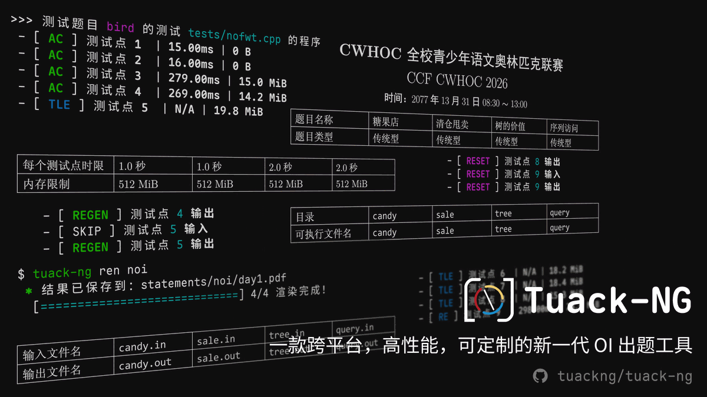

<!--
  这是 Tuack-NG 的示例模板，用来演示题面和各项功能的常用写法/用法。

  如果要配置 `conf.json`，见 https://docs.tuack-ng.ink/app/project/config.html。
-->

<!--
  您可以在题面里像这样写注释；注释不会出现在渲染结果中。

  如果您想要一个空白模板，请使用 `tuack-ng gen empty`。

  Tuack-NG 的题面使用 Markdown 编写，支持大部分常用语法，比如：

  - 文本样式：**加粗**、*斜体*、~~删除线~~、`行内代码`
  - 标题：`#` 到 `######`
  - 列表：`-` 无序列表、`1.` 有序列表
  - 引用：`>`
  - 代码块：``` 包裹，可标注语言
  - 链接：`[文字](链接)`
  - 图片：``，也支持 `:::figure` 与 `{width=...}`、`{height=...}`，详见下文。
  - 表格：支持对齐，可用 `^` 向上合并单元格、用 `<` 向左合并单元格，也可以使用 Lua 表格，详见下文。
  - 公式：行内 `$...$`，行间 `$$...$$`
  - 注释：HTML 注释

  完整语法见 <https://docs.tuack-ng.ink/app/ren/format/syntax.html>。
-->

<!--
  题目背景：可选，通常是情景引入等；不阅读也不应影响题意理解。

  如果不需要，可以删除本节。
-->
## 题目背景

这里曾经有一个温馨的故事。

<!--
  使用 `:::figure` 来插入图片，可选加入说明文字。

  在图片后面可以加上 `{width=<width>, height=<height>}` 设置宽高，至少写一个即可。

  （这只是示例，实际题面中不需要包含这一部分。）
-->
:::figure{caption="本题面由 Tuack-NG 生成"}
{width=60%}
:::

<!--
  题目描述：概括题意和必要的定义。
-->
## 题目描述

这是一道题目。

<!--
  您可以使用模板语法（`{{ }}`）动态获取题目信息，避免在题面中写死导致信息过时。

  模板语法详见 https://docs.tuack-ng.ink/app/ren/format/template.html。

  （实际题面中不需要包含下面几行，它们仅供演示。）
-->
本题共有 {{ problem.data | length }} 个测试点（{{ data_cases | length }} 个数据点组）、{{ problem.subtasks | length }} 个子任务和 {{ problem.samples | length }} 组样例；时间限制 {{ problem["time limit"] }} 秒，空间限制 {{ problem["memory limit"] }}。

<!--
  输入格式：说明输入的内容与格式；

  statement.input_file() 会按文件 IO 设置补充读入方式，形如「从文件 *题目名*.in 中读入数据。」或「从标准输入读入数据。」
-->
## 输入格式

{{ statement.input_file() }}

本题可能没有输入。

<!--
  输出格式：说明输出的内容与格式；

  statement.output_file() 会按文件 IO 设置补充输出方式，形如「输出到文件 *题目名*.out 中。」或「输出到标准输出。」
-->
## 输出格式

{{ statement.output_file() }}

本题可能没有输出。

<!--
  样例：建议把样例放在 sample/ 目录下，用 `sample.text(<id>)` / `sample.file(<id>)` 嵌入题面；
  详见 https://docs.tuack-ng.ink/app/ren/format/template.html#sample

  下面这行（`sample.text()`）会将样例 1 的输入输出嵌入题面。
-->
{{ sample.text(1) }}

<!--
  样例解释：可选，说明样例为什么得到这个输出。
-->
## 样例 1 解释

暂时无法给出合理的解释。

<!--
  下面这行（`sample.file()`）只给出样例 2 的文件引用，不会把内容嵌入题面。
-->
## 样例 2

{{ sample.file(2) }}

<!--
  数据范围：列出子任务、分值和特殊性质等，建议使用表格。
-->
## 数据范围

<!--
  您可以使用配置中的 `args` 动态配置参数。

  您可以使用 `tools.hn`、`tools.comma`、`tools.spaces`、`tools.sci`、`tools.int_lg`、`tools.cases` 等函数或过滤器来格式化数字，如下所示。

  详见 https://docs.tuack-ng.ink/app/ren/format/template.html#tools
-->
对于所有数据，保证 $1 \le n \le {{ problem.args.n | tools.hn }}$，$1 \le m \le {{ problem.args.m | tools.hn }}$。

<!--
  可以在题面中使用原生 Markdown 表格，用 `^` 和 `<` 合并单元格。
-->
|   测试点   | 特殊性质 A | 特殊性质 B | 特殊性质 C |
| :--------: | :--------: | :--------: | :--------: |
| $1\sim 3$  |     是     |     <      |     否     |
| $4\sim 6$  |     是     |     否     |     <      |
| $7\sim 10$ |     否     |     ^      |     <      |

<!--
  Markdown 表格不易支持动态内容，可以改用 Lua 表格。

  使用 `{{ statement.table("文件路径") }}` 来引用 Lua 表格，通常把表格放在 `tables/` 目录下。
  Lua 表格的写法详见 https://docs.tuack-ng.ink/app/ren/format/lua.html

  建议您查看下面两个文件的内容。
-->
{{ statement.table("tables/data.lua") }}

{{ statement.table("tables/data_map.lua") }}

<!--
  您也可以添加其他标题，比如「提示」。

  总之，以上仅供参考，您可以按自己喜欢的方式编写题面。

  另外，还有一些示例代码：

  - chk/：Checker（SPJ）示例
  - gen/：Generator（数据生成器）示例
  - tests/：标程/测试代码示例
  - val/：Validator（数据校验器）示例

  各文件开头都说明了启用方法和参考链接。

  最后，尽情创作吧！
-->
