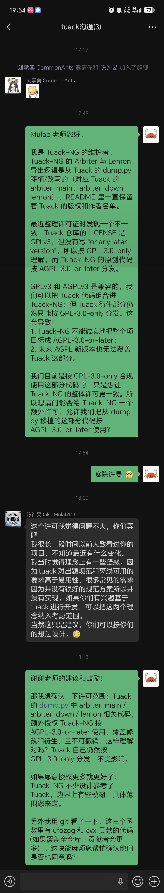
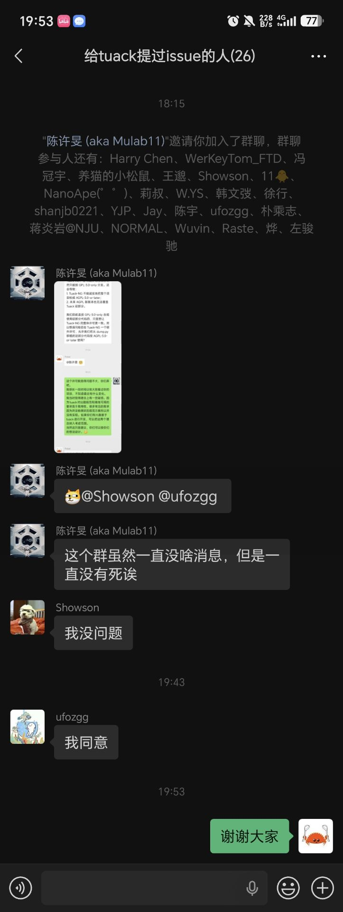

# 关于 Tuack 的许可证

Tuack（<https://gitee.com/mulab/oi_tools>）的 `LICENSE` 是 GPLv3，但没有声明 "or any later version"，因此按 **GPL-3.0-only** 理解。

Tuack-NG 的 Arbiter 与 Lemon 导出逻辑移植并改写了 Tuack `tuack/dump.py` 中的 `arbiter_main`、`arbiter_down`、`lemon`。Tuack-NG 的原创代码按 **AGPL-3.0-or-later** 分发。

GPLv3 与 AGPLv3 兼容，可以组合分发；但 Tuack 衍生部分原本仍受 GPL-3.0-only 约束。为避免 Tuack-NG 的整体许可声明不准确，Tuack-NG 向 Tuack 作者申请了额外许可。

## 许可范围与条款

Tuack `tuack/dump.py` 中的以下函数，以及它们在 Tuack-NG 中的对应实现：

- `arbiter_main`
- `arbiter_down`
- `lemon`

对应 Tuack-NG 文件：

- `crates/tuack-utils/src/dump/arbiter.rs`
- `crates/tuack-utils/src/dump/lemon.rs`

以及上述代码的修改、衍生和后续重构。

Tuack 本身继续按 GPL-3.0-only 分发，不受影响；额外授权 Tuack-NG 按 AGPL-3.0-or-later，即 `GPL-3.0-only OR AGPL-3.0-or-later` 使用，覆盖修改和衍生，且不可撤销。

## 请求与确认

<!-- autocorrect-disable -->
2026-11-08，在微信群「给 tuack 提过 issue 的人」中，Tuack-NG 维护者 Pulsar33550336 向 Tuack 作者请求：
<!-- autocorrect-enable -->

> Tuack 的 dump.py 中 arbiter_main / arbiter_down / lemon 相关代码，额外授权 Tuack-NG 按 AGPL-3.0-or-later 使用，覆盖修改和衍生，且不可撤销。

确认：

| 姓名/昵称                                   | 身份                         | 确认                                   |
| ------------------------------------------- | ---------------------------- | -------------------------------------- |
| 陈许旻（Mulab）<chen.xm.mu@gmail.com>       | Tuack 作者；`dump.py` 贡献者 | 「这个许可我觉得问题不大，你们弄吧。」 |
| cyx（微信群昵称 Showson）<646370255@qq.com> | `dump.py` 贡献者             | 「我没问题」                           |
| ufozgg <657228726@qq.com>                   | `dump.py` 贡献者             | 「我同意」                             |

聊天记录截图：

